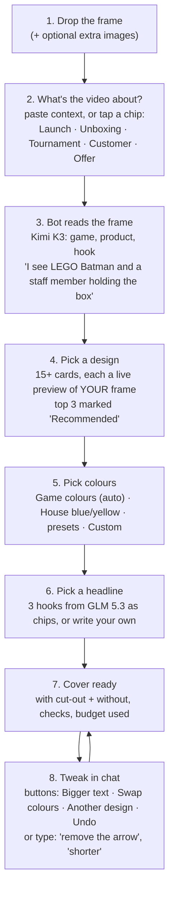
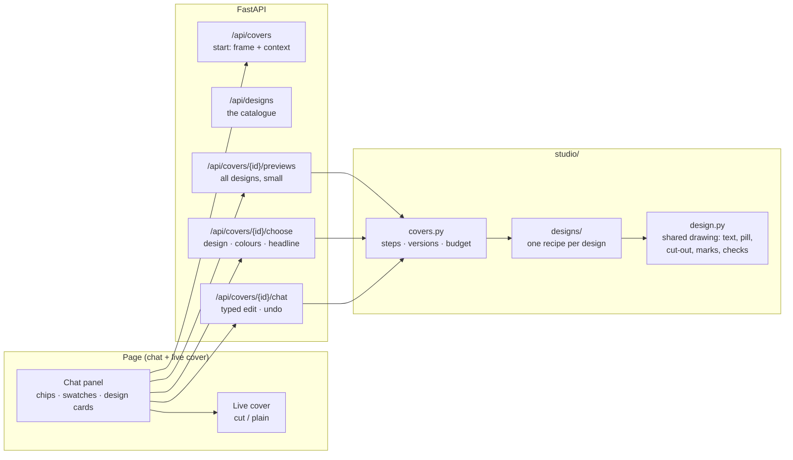

# Plan: Chat Studio — pick colours and a design before the cover is made

> Plan only, no code yet. Builds on Thumbnail Studio as committed (`a1a1120`).

**The idea:** making a cover becomes a short chat. The bot asks one thing at a time, and the user answers by
tapping chips, colour swatches and design cards rather than typing. Typing still works for edits ("make the headline
red"). The cover on the right updates live after every answer.

---

## 1. The chat, step by step

Every step can be skipped with a **"You choose"** chip, which takes the AI's pick, so three taps get you a cover.
Going back to any earlier step keeps the later answers when they still fit.

### What the screen looks like

| Left: the chat | Right: the live cover |
|---|---|
| Bot bubbles with chips, swatches and design cards; the user's picks shown as their bubbles | The cover as it stands (cut-out and plain versions), the budget meter, the checks |
| An input box at the bottom for typed edits | Download buttons, plus the 3:4 grid preview toggle |

On a phone the cover sits on top, collapsed to a thumbnail, and the chat sits below it.

---

## 2. Colour picking (before generation)

The colour step offers four kinds of choice:

| Choice | What it does |
|---|---|
| **Game colours (auto)** | Kimi's pick from the game's key art (today's behaviour) |
| **House** | PlayStation blue `#0050D0` + yellow `#FFC400` on navy or white |
| **Presets** (8–10) | Wolverine yellow/black · FC navy/neon green · Ghost white/gold/red · AC navy/white · GTA pink/purple · Red Dead red/yellow · Days of Play blue · Mono black/white |
| **Custom** | A picker for each role below, with recent colours and colours taken from your frame |

**Colour roles** (each one can be set, or left on auto):

| Role | Used for |
|---|---|
| Background | the wash behind the words, solid backgrounds, the blurred tint |
| Big text | the huge punch line |
| Small text | the setup line |
| Highlight | the one emphasised word |
| Pill | the pill's filled half (its text colour is picked automatically for contrast) |
| Outline / glow | the cut-out's outline and glow, the ring and the arrow |

**Readability guard:** if a chosen pair is hard to read (contrast under 3:1), the bot says so ("Yellow on white is
hard to read in the grid") and offers **Add outline** or **Use navy instead**. It never silently changes your
choice.

**My palettes:** save a custom set under a name and it appears as a preset next time. Saved palettes are kept in
`data/palettes.json`.

---

## 3. The designs (16, all taken from the reference covers)

Each design is a recipe drawn by code from your frame: no image generation, so previews are free and instant.

| # | Design | From the references | Background | Subject | Words | Extras |
|---|---|---|---|---|---|---|
| 1 | **Staff Hook** | FC27 tournament host, Happy Customer | white studio, blue/yellow swooshes | cut-out person, centre | two-tone headline at the top | wave |
| 2 | **Question Hook** | "Which's your favourite childhood game?" | themed (space / colour flood) | cut-out person, pointing | question in 2 sizes | sparkles, floating PS shapes |
| 3 | **Studio Pedestal** | Street Fighter 6, Final Fantasy Resonance | soft white studio | product on a glossy podium | title + "Available \| Now" pill | reflection |
| 4 | **Spotlight Unbox** | T.Flight Hotas, Thrustmaster 248R | dark, one spotlight beam | product on a cube | "LET'S UNBOX" + product name | beam, haze |
| 5 | **Colour Flood** | Wolverine yellow "Unbox & Tag Us" | solid game colour | product on a rock/podium | big black title, pill | grain |
| 6 | **Key Art Cinematic** | AC Black Flag, Wolverine dark | the frame full-bleed, darkened | the frame itself | logo-style title top, small pill | vignette |
| 7 | **Midnight Launch** | Midnight Launch box on blue drape | navy to blue gradient | product on a draped plinth | "MIDNIGHT / LAUNCH", date line | stars |
| 8 | **Group Event** | FC26 Tournament, Midnight Launch group | white seamless studio | group cut-out, wide | event name big | confetti (optional) |
| 9 | **Winner Card** | Tokon winner, Lucky Draw winner | dark blue with a glow | winner cut-out | name pill + event + "winner" tag | trophy icon |
| 10 | **Event Flyer** | "The Battle Begins" | light with art strip | small frame card | title, date block, "FREE registration" | QR code |
| 11 | **Interview Moment** | "Moments from Wolverine launch" | the frame, blurred edges | the frame, punch-in | "MOMENTS FROM" + event | mic badge |
| 12 | **Date Teaser** | First Light 27.05.2026 | black with a light beam | silhouette (cut-out darkened) | spaced title + big date | — |
| 13 | **Framed Card** | Mortal Kombat Tournament | colour flood | the frame tilted in a white card | outlined (hollow) word + solid word | characters at the bottom |
| 14 | **Sunset Poster** | Red Dead Redemption | red to yellow sky | cut-out as a dark silhouette on a sun disc | western-style title | — |
| 15 | **Celebration** | 10 Years of Uncharted, 50K Family | key art or white | the frame or a group | "CELEBRATING" + number huge | confetti, number badge |
| 16 | **Hand + Product** | "Play More, Store More" WD SSD | white with a pattern of the product name | hand-held product, punch-in | two-line slogan | wave |
| 17 | **Collage** *(needs 2–4 images)* | "Pre-Order Now" 4-game grid | light, yellow pill | 2×2 grid of your images | "PRE ORDER NOW" | — |
| 18 | **Offer** *(needs a price or offer in the context)* | PS Wallet Top-ups, Days of Play | blue with a white swoosh | product / gift cards floating | offer big, ₹ amount | price tag badge |

**Recommended designs:** Kimi already reads the frame, so the same call also returns the top 3 designs for it. A
person in frame suggests Staff Hook or Question Hook; a box in hand suggests Hand + Product or Spotlight Unbox; key art
suggests Key Art Cinematic or Date Teaser. This adds about 100 output tokens, roughly $0.0015.

**Design cards:** each card is the design drawn small (270×480) from your actual frame with placeholder words, so
the user picks by seeing the result. All 18 render in about 3–4 s and are cached per cover.

---

## 4. A few more features

| Feature | What it gives the user |
|---|---|
| **3 headline options** | GLM writes 3 hooks in one call; tap one or write your own |
| **Quick tweak buttons** | Bigger text · Swap colours · Another design · Remove arrow · Undo, all free (code only) |
| **Typed edits** | "Make the headline red", "say 'in stock' instead": GLM 5.3 Flash turns the message into a change (~$0.0005); simple ones like colours and on/off are handled by code for free |
| **Undo / history** | Every change is a version; tap any earlier bubble to go back |
| **More sizes** | 9:16 reel cover, 4:5 feed post, 1:1, 16:9 YouTube, all from one design |
| **Extra inputs when a design needs them** | Date and time (Midnight Launch, Date Teaser), a name (Winner), a link for the QR code (Flyer), 2–4 images (Collage) |
| **Covers library** | Your recent covers as thumbnails; open one to continue its chat |
| **Profile grid preview** | The new cover beside your last 8 covers at the 3:4 crop |

---

## 5. How it fits the current code

**Changes:**
- **`designs/` package:** one small file per design, each a recipe: background, subject treatment, text layout,
  extras. They share today's drawing code: text, pill, cut-out, ring and arrow, face protection and checks.
- **Spec:** gains `design`, a `colors` set (the 6 roles, each set or auto) and `extras` (date, name, QR link, extra
  images).
- **Cover state:** gains `messages` (the chat), `step` and `versions` (for undo).
- **The look step (Kimi):** also returns the 3 recommended designs. **The write step (GLM):** returns 3 headline
  options instead of 1.
- **Unchanged:** Nebius only; the $0.15 budget checked before every call, chat edits included; nothing ever drawn over
  a face; every version checked.

---

## 6. Cost of one chat

| Step | Model | Cost |
|---|---|---|
| Read the frame, render 18 design previews | code | free |
| Look + recommend designs | Kimi K3 | ~$0.009 |
| 3 headline options | GLM 5.3 | ~$0.003 |
| Each typed edit | GLM 5.3 Flash | ~$0.0005 |
| Buttons, colours, design changes, undo | code | free |
| **Typical cover with 5 typed edits** | | **~$0.015 of the $0.15 budget** |

The budget meter stays on screen. When a typed edit can't fit in what's left, the bot says so and offers the free
buttons instead.

---

## 7. Build order

| Phase | Scope | Result |
|---|---|---|
| **1. Designs and colours** | The `designs/` package with the 16 frame-only designs; the colour roles and presets; the preview renderer | Every design works from the API |
| **2. Chat page** | The guided chat (steps 1–8) with chips, swatches, design cards, live cover; recommended designs; 3 headline options | The user-friendly flow, end to end |
| **3. Edits and history** | Quick buttons, typed edits, undo, my palettes, covers library | Fast iteration |
| **4. Extras** | Collage and Offer (extra inputs), QR, more sizes, profile grid preview | The remaining designs and outputs |

Each phase ends with tests, live covers on real frames and a browser check.

---

## 8. Decisions for you

1. **Typed edits:** handled by GLM 5.3 Flash (~$0.0005 each, understands anything), or buttons and simple
   commands only (free, more limited)?
2. **Collage and Offer designs:** build them in phase 4, or drop them and keep the 16 frame-only designs?
3. **The order of steps:** design → colours → headline as planned, or headline first (the words can shape the design)?
4. **Fonts:** keep the one heavy sans-serif, or offer 3 type styles (heavy sans, condensed, western/serif for designs
   like Sunset Poster)?
